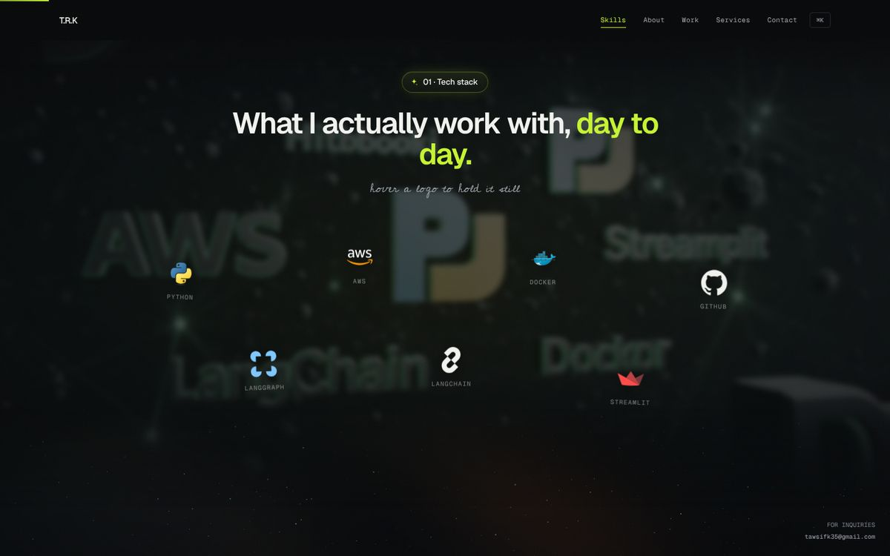
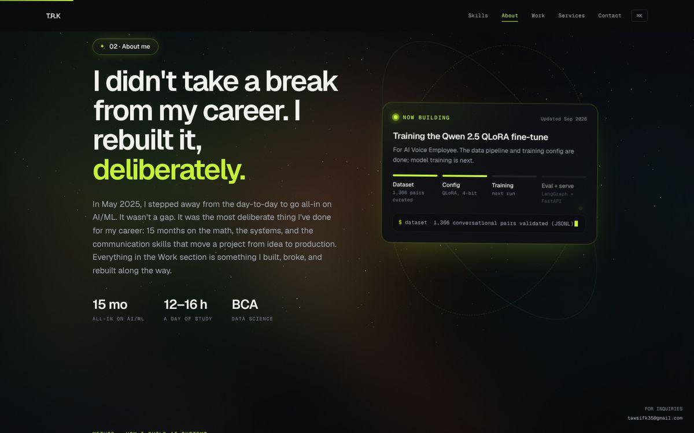
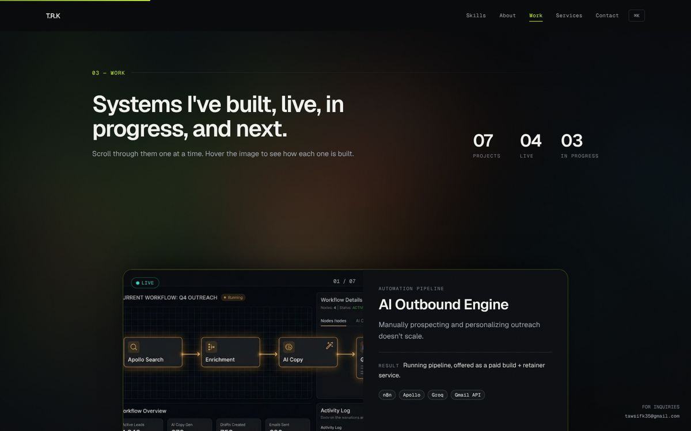
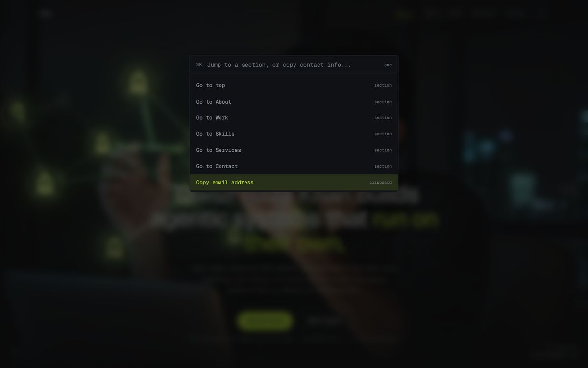
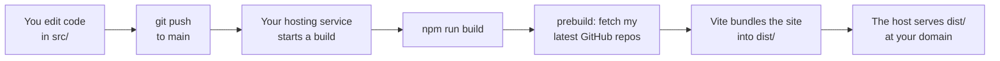
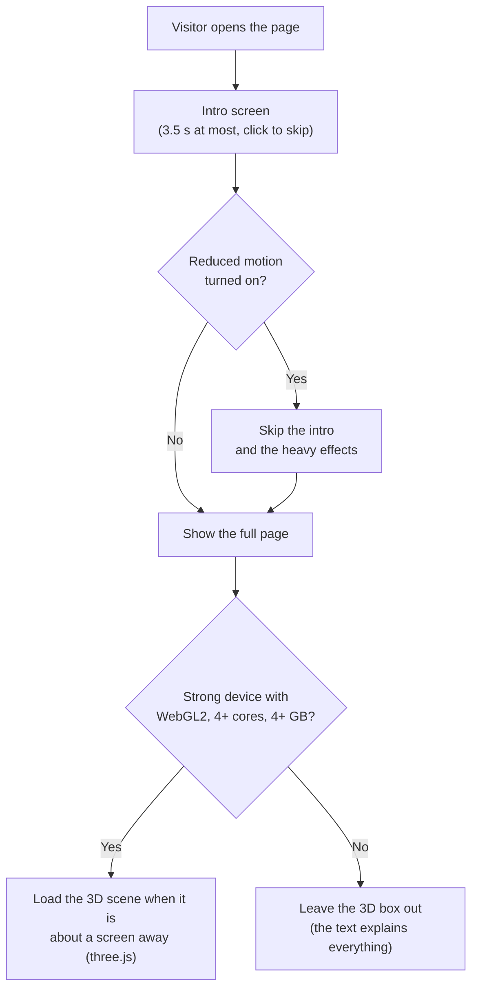
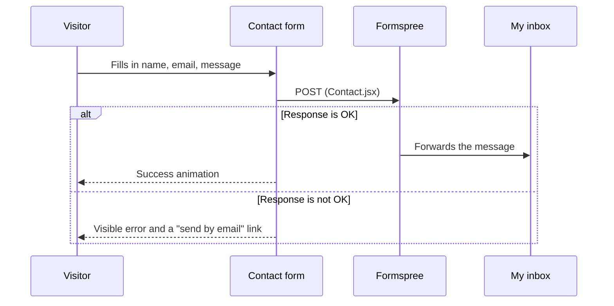

<div align="center">

# Tawsif Raza Khan — Portfolio

**A dark, motion-heavy one-page portfolio for an AI/ML engineer who builds agentic systems.**

[](https://main.dahjkchabvbri.amplifyapp.com/)


</div>

---

## Contents

1. [What is this?](#1-what-is-this)
2. [A quick tour](#2-a-quick-tour)
3. [Tech stack](#3-tech-stack)
4. [Run it on your computer](#4-run-it-on-your-computer)
5. [How the project is organised](#5-how-the-project-is-organised)
6. [How it works (the workflow)](#6-how-it-works-the-workflow)
7. [Customise it — copy-paste examples](#7-customise-it--copy-paste-examples)
8. [Deploying](#8-deploying)
9. [Performance and accessibility](#9-performance-and-accessibility)
10. [Troubleshooting](#10-troubleshooting)
11. [Known gaps](#11-known-gaps)
12. [License](#12-license)

---

## 1. What is this?

This is the source code of my personal website. It is a **single page**: you scroll down and meet me, my skills, my projects, the services I offer, and a contact form.

It is built with **React** (to build the page from small reusable pieces) and **Vite** (a fast tool that runs and bundles the site). There is no backend and no database. The result is a folder of plain static files that any web host can serve.

In one sentence: **`npm run build` turns this repo into a `dist/` folder, and that folder *is* the website.**

---

## 2. A quick tour

The page is made of sections, shown here in the order they appear on the site.

| Section | What the visitor sees | Code |
| :--- | :--- | :--- |
| **Intro** | A ~6.5 s cinematic opening: a photographic 3D Earth falls into frame, lands with a shockwave, wires up a network of agent nodes while three lines of text play, then breaks apart into grains that swarm together and spell the name. Plays once per browser session; click or press any key to skip. Text-only on weaker devices. Earth textures are in `public/intro/`. | `components/IntroSequence.jsx`, `components/introPlanet.js` |
| **Hero** | Full-screen film background, headline, two buttons. | `sections/Hero.jsx` |
| **Skills** (`#skills`) | Tech logos floating over a video. Hover a logo to freeze it. | `sections/SkillsFloat.jsx` |
| **About** (`#about`) | My story, plus a live "NOW BUILDING" status card. | `sections/AboutSpace.jsx` |
| **Experience** (`#experience`) | Work history as a timeline, then education and certifications, with a resume button. *Hidden until `data/experience.js` has an entry.* | `sections/Experience.jsx` |
| **Work** (`#projects`) | Seven projects as a sticky stack of cards. Projects with no public link offer a walkthrough instead. Every card has an "Ask the AI about this" button that opens the Ask Tawsif chat with a question about that project already sent. The list lives in `data/projects.js`; the hero and Proof counts are read from it. | `sections/Projects.jsx` |
| **Services** (`#services`) | What I can build for clients, and how an engagement runs in three steps. | `sections/Services.jsx` |
| **Methodology** | "How I build AI systems": a step-by-step process, with a small 3D scene on capable devices. | `sections/EngineeringMethodology.jsx` |
| **Architecture** | Interactive blueprints of systems in production, with their failure fallbacks. "Run a sample task" steps a scripted task through the stages and stops at the human approval gate; it is a simulation on sample data, edited in `data/demoRuns.js`. | `sections/ArchitectureShowcase.jsx`, `components/AgentRun.jsx` |
| **Proof** | Four figures taken from the projects above. | `sections/EngineeringImpact.jsx` |
| **GitHub activity** | My latest repos, fetched at build time. | `components/GithubActivity.jsx` |
| **Testimonials** | *Hidden until a real quote is added.* | `sections/Testimonials.jsx` |
| **Contact** (`#contact`) | A contact form that sends to my inbox. The visitor first picks "I need something built" or "I'm hiring for a role", then taps a few answers that are written into the message for them. The questions and answers live in `data/contactBrief.js`. | `sections/Contact.jsx` |
| **Footer** | Links, plus the "Soft Stack" drawer. | `sections/Footer.jsx` |

<table>
  <tr>
    <td width="50%"><br><sub><b>Skills</b> — floating logos over a video. Hover one to hold it still.</sub></td>
    <td width="50%"><br><sub><b>About</b> — my story and the live "NOW BUILDING" card.</sub></td>
  </tr>
  <tr>
    <td width="50%"><br><sub><b>Work</b> — projects stack as you scroll, with a Live / In progress badge.</sub></td>
    <td width="50%"><br><sub><b>Command palette</b> — press <kbd>Ctrl</kbd>+<kbd>K</kbd> (<kbd>⌘</kbd>+<kbd>K</kbd> on Mac).</sub></td>
  </tr>
</table>

### Small details worth knowing

- **Command palette.** Press <kbd>Ctrl</kbd>/<kbd>⌘</kbd> + <kbd>K</kbd> (press it again to close), or tap the `[ Ctrl K ]` button in the nav on a phone. Commands are grouped into Navigation, Actions and Social; type a few letters (for example `con`) to filter, use the arrow keys, and press <kbd>Enter</kbd>. "Download resume" appears once a resume is added (see [Known gaps](#11-known-gaps)).
- **Soft Stack drawer.** A slide-out panel opened from the footer (beliefs, soft skills, reading). It traps keyboard focus, closes on <kbd>Esc</kbd>, and locks page scroll while open.
- **Honest contact form.** If sending fails, the form shows a visible error and a "send by email instead" link. It never pretends the message was sent.

---

## 3. Tech stack

| Layer | Tool | Why it is here |
| :--- | :--- | :--- |
| Framework | **React 19** | Builds the page from small reusable components. |
| Build tool | **Vite 8** | Instant dev server and an optimised production build. |
| Styling | **Tailwind CSS 4** | Style with short class names such as `text-paper bg-bg`. |
| Animation | **Framer Motion 12**, **GSAP 3** | Scroll effects, the intro, and the stacked project cards. |
| 3D | **three.js** + **@react-three/fiber** | The 3D "living system" scene. |
| Icons | **lucide-react** + inline SVG logos | UI icons and brand logos. |
| Linting | **oxlint** | A very fast code checker. |
| Contact form | **Formspree** | Receives form posts, so no backend is needed. |
| Hosting | **AWS Amplify** | Live at <https://main.dahjkchabvbri.amplifyapp.com/>. See [Deploying](#8-deploying). |

> **Node.js 20.19+ or 22.12+ is required.** Vite 8 will not run on older versions.

---

## 4. Run it on your computer

```bash
# 1. Get the code
git clone https://github.com/tawsif-raza/tawsif-portfolio.git
cd tawsif-portfolio

# 2. Install the packages (one time)
npm install

# 3. Start the dev server
npm run dev
```

Open the address that Vite prints (usually <http://localhost:5173>). The page reloads whenever you save a file.

### Commands

| Command | What it does | When to use it |
| :--- | :--- | :--- |
| `npm run dev` | Starts the dev server with live reload. | While you are editing. |
| `npm run lint` | Checks the code for mistakes. | Before every commit. |
| `npm run build` | Fetches fresh GitHub data, then builds the site into `dist/`. | Before deploying. |
| `npm run preview` | Serves the built `dist/` folder locally. | To test the real production build. |

> **Tip:** `npm run dev` is for editing and `npm run preview` is for checking the real result. Run `build` before `preview`, because `preview` only serves what is already in `dist/`.

---

## 5. How the project is organised

```text
tawsif-portfolio/
├── index.html                  # The one HTML page: title, SEO tags, fonts, JSON-LD
├── package.json                # Dependencies and the npm commands above
├── vite.config.js              # Vite setup (React + Tailwind plugins)
├── tailwind.config.js          # Colours and fonts, mirrored from src/index.css
├── .oxlintrc.json              # Linter rules
├── STATUS.md                   # Honest log of what is built and what is missing
│
├── public/                     # Files served as-is (not processed by Vite)
│   ├── hero/                   #   Hero videos (1080p + 720p) and poster images
│   ├── skills/                 #   Skills background videos and poster
│   ├── project-*.jpg           #   One screenshot per project card
│   ├── logo.svg, logo.png      #   TR monogram (the nav uses the SVG)
│   ├── favicon.svg, favicon.ico, icon-*.png #   Icons for browser tabs and phones
│   ├── apple-touch-icon.png    #   iPhone home-screen icon
│   ├── og-image.png            #   Preview image shown when the link is shared
│   └── manifest.json, robots.txt, sitemap.xml
│
├── scripts/
│   ├── fetch-github-activity.mjs   # Runs before every build (see section 6)
│   ├── gen-logo-assets.py          # Draws the TR logo and every icon (no source image needed)
│   └── gen-brand-assets.py         # Draws the share image (og-image.png) with the same TR mark
│
├── docs/
│   └── screenshots/            # The pictures used in this README
│
└── src/
    ├── main.jsx                # Starts React
    ├── App.jsx                 # ★ The order of all sections lives here
    ├── index.css               # ★ Colours, fonts and shared styles (Tailwind @theme)
    ├── sections/               # Big page blocks (Hero, Projects, Contact, …)
    ├── components/             # Small reusable pieces (Nav, CommandPalette, …)
    ├── data/                   # projects, experience, site links, logos, graph data, github-activity.json
    ├── hooks/                  # useReducedMotion, useInViewport, useNearViewport
    └── utils/                  # canGoFullGL (is this device strong enough for 3D?)
```

**Rule of thumb:** a *section* is a big block of the page, and a *component* is a small piece used inside sections. To change the **order** of the page, edit `src/App.jsx`. To change the **content** of a block, edit its file in `src/sections/`.

---

## 6. How it works (the workflow)

### From code to website

The site is hosted on AWS Amplify (see [section 8](#8-deploying)). With the repo connected to a host, this is what happens on every push:



### What happens when someone opens the site



### The GitHub activity step (runs by itself)

`npm run build` first runs `scripts/fetch-github-activity.mjs`. It asks the public GitHub API for my repo count and my 3 most recently pushed repos, and saves the answer in `src/data/github-activity.json`. The "GitHub activity" section reads that file.

Why do it at build time?

- Visitors never call the GitHub API, so there are **no rate limits** for them.
- The site stays fast and works even if GitHub is down.
- The numbers refresh on **every deploy**.

**If the fetch fails** (for example a rate limit), the script keeps the old file and the build still succeeds. It never invents numbers:

```text
[github-activity] fetch failed (GitHub API returned 403/403) -- keeping existing data file
```

That message is a harmless warning, not an error.

### The contact form



### Safety checks before you push

Run these two commands. Both pass on the current code:

```bash
npm run lint    # finds mistakes
npm run build   # proves the site still builds
```

There is no automated test suite or CI workflow in this repo yet, so these two commands are the safety net. See [Known gaps](#11-known-gaps).

---

## 7. Customise it — copy-paste examples

### Example 1 — Add a new project

Open `src/sections/Projects.jsx` and add one object to the `PROJECTS` list:

```jsx
{
  title: "My New Project",
  category: "Automation workflow",
  status: "live",                       // "live" or "progress"
  problem: "One sentence: what problem does it solve?",
  approach: "How you built it, in plain words.",
  outcome: "What happened. Be honest and specific.",
  stack: ["n8n", "Gemini", "Gmail API"], // shown as small tags
  link: "https://github.com/tawsif-raza/my-new-project", // or null for no link
  image: `${BASE}project-new.jpg`,       // see the next step
},
```

Then put your screenshot in `public/project-new.jpg`.

The "07 projects / 04 live / 03 in progress" counters at the top of the section **update by themselves**.

### Example 2 — Change the brand colours

Colours are defined once, in the `@theme` block at the top of `src/index.css`:

```css
@theme {
  --color-bg: #08090b;       /* page background */
  --color-accent: #c6f432;   /* the lime green used for highlights */
  --color-paper: #f2f3ef;    /* main text colour */
}
```

Change `--color-accent` to `#ff7a59` and every highlight turns orange. Then update the same value in `tailwind.config.js` so both files agree.

### Example 3 — Change my contact email

The address `tawsifk35@gmail.com` is written in **four files**. Search for it and replace all of them:

```bash
grep -rn "tawsifk35@gmail.com" src
# src/components/CommandPalette.jsx
# src/components/Nav.jsx
# src/sections/Contact.jsx
# src/sections/Footer.jsx
```

Also remember the Formspree address in `src/sections/Contact.jsx`. It decides **where the form messages are delivered**:

```jsx
const response = await fetch("https://formspree.io/f/xvgozzwn", { /* … */ });
```

### Example 4 — Add a real testimonial

In `src/sections/Testimonials.jsx`, put a real quote in the empty list. The whole section appears automatically:

```jsx
const TESTIMONIALS = [
  { quote: "Delivered ahead of schedule and it just works.", name: "Jane Doe", role: "Founder, Acme" },
];
```

### Example 5 — Add a tech logo to the Skills section

Open `src/data/floatLogos.js` and add an entry. Use a free logo from [devicon](https://devicon.dev/) or [Simple Icons](https://simpleicons.org/):

```js
{ "name": "FastAPI", "glow": "#009688", "svg": "<svg viewBox=\"0 0 24 24\" …>…</svg>" },
```

`glow` is the colour that lights up when someone hovers the logo.

### Example 6 — Reorder or remove a section

Open `src/App.jsx`. Sections render top to bottom in the order they are written inside `<main>`:

```jsx
<Hero />
<Projects />
<Services />
{/* delete or comment out a line to remove that section */}
<Contact />
```

### Example 7 — Use a different GitHub account for the activity data

Change one line in `scripts/fetch-github-activity.mjs`:

```js
const USERNAME = "tawsif-raza";
```

---

## 8. Deploying

**The site is live on AWS Amplify at <https://main.dahjkchabvbri.amplifyapp.com/>.** There is no custom domain yet. The address-based tags (canonical link, link-preview image, sitemap) point at the Amplify address.

### Build settings (the same on every host)

Every static host asks the same three questions:

| Setting | Value |
| :--- | :--- |
| Install command | `npm ci` |
| Build command | `npm run build` |
| Output / publish folder | `dist` |
| Node version | 20.19+ or 22.12+ |

Vercel, Netlify, Cloudflare Pages and AWS Amplify all work. Connect the GitHub repo, enter the settings above, and every push to `main` will rebuild the site.

### If the address changes

The site's full address is written in three files. If you move to a custom domain, change it in all three:

1. **`index.html`**: the block marked "Address-based tags" (canonical, `og:url`, `og:image`, `twitter:url`, `twitter:image`) and the `"url"` line in the JSON-LD.
2. **`public/sitemap.xml`**: the `<loc>` line.
3. **`public/robots.txt`**: the `Sitemap:` line.

Then paste the new link into the [LinkedIn Post Inspector](https://www.linkedin.com/post-inspector/). You should see `public/og-image.png`.

### Visitor analytics (optional)

The site can load [Cloudflare Web Analytics](https://www.cloudflare.com/web-analytics/) (free, no cookies). It stays off until you give the build a site token:

1. Create a Cloudflare account, add the site under **Web Analytics**, and copy the token from the snippet it shows.
2. In the Amplify console, add an environment variable `VITE_CF_ANALYTICS_TOKEN` with that token, then redeploy.

Without the variable no analytics script is loaded. It is never loaded in `npm run dev`.

---

## 9. Performance and accessibility

This site has a lot of motion, so it is built to behave on weak devices and for people who dislike motion.

- **Respects `prefers-reduced-motion`.** If the visitor's system asks for less motion, animations are turned off or simplified. The hook (`hooks/useReducedMotion.js`) also reacts live if the setting changes while the page is open.
- **Pauses what you cannot see.** Videos and canvas animations stop when they scroll off-screen or the tab is hidden (`hooks/useInViewport.js`).
- **Smart 3D loading.** The heavy three.js scene (in Methodology and Architecture) is only downloaded on devices that can handle it, and only when it is about a screen away from view. The check (`utils/canGoFullGL.js`) needs WebGL2, 4+ CPU cores, 4+ GB of memory and no reduced-motion preference. On other devices the 3D box is simply left out, and the text around it explains everything.
- **Adaptive video.** The hero has 1080p (about 3.9 MB) and 720p versions plus a poster image, so the first paint never waits for the video.
- **Keyboard friendly.** The command palette and the Soft Stack drawer trap focus, close on <kbd>Esc</kbd>, and return focus when they close.
- **SEO basics.** Open Graph and Twitter titles and descriptions, JSON-LD `Person` data, `robots.txt`, a web manifest and a dedicated share image. The address-based tags and `sitemap.xml` use the live address (see [section 8](#8-deploying)).

---

## 10. Troubleshooting

| Problem | What it means | Fix |
| :--- | :--- | :--- |
| `[github-activity] fetch failed (… 403/403)` during build | GitHub's anonymous rate limit (60 requests per hour per IP). | Ignore it. The build keeps the last good data. Try again later for fresh numbers. |
| `The engine "node" is incompatible` or Vite won't start | Your Node.js is too old. | Install Node 20.19+ or 22.12+. |
| Build warning: *Some chunks are larger than 500 kB* | The three.js 3D scene is a big chunk (about 245 kB gzipped). | Expected. It loads only on capable devices. |
| `npm run preview` shows an error or a blank page | `dist/` does not exist yet. | Run `npm run build` first. |
| Page seems stuck on the intro screen | The intro waits for its animation. | Click or press any key to skip. It also self-skips after 3.5 seconds. |
| No 3D scene in Methodology or Architecture | Reduced motion is on, or the device is too weak. | This is intentional (see section 9). |
| Contact form shows an error | Formspree did not accept the request. | Check the form ID in `Contact.jsx` and the Formspree dashboard. The form already offers a "send by email" fallback. |

---

## 11. Known gaps

An honest list, mirrored from [STATUS.md](STATUS.md) plus what a full audit of the repo found.

**Content**

- **No resume or work history yet.** To add the resume, save the PDF as `public/resume.pdf` and set `RESUME_URL` in `src/data/site.js`; the button then appears in the Experience section, the footer and the command palette. To add work history, education and certifications, fill the lists in `src/data/experience.js`; the Experience section appears with the first role.
- No testimonials yet (the section stays hidden until real quotes are added).
- **Project demos.** No project has a demo clip yet. Add `demo: "https://..."` to a project in `src/data/projects.js` and its card shows a "Watch demo" link.
- **Analytics is off** until `VITE_CF_ANALYTICS_TOKEN` is set (see [section 8](#8-deploying)).

**Engineering**

- **No automated tests and no CI workflow.** `.github/` does not exist, so nothing checks a push except you running `lint` and `build`.
- **Real-device testing is limited.** So far only build, lint and dev-server checks, not real phones or Safari/Firefox.
- **Chat assistant can be slow to start.** Ask Tawsif runs on a free server that sleeps when idle. The page pings it on load to give it a head start, but the first reply can still take a while. The server only answers the live address, so in `npm run dev` the chat opens but every question fails.
- **Voice in the chat depends on the browser.** The mic button uses the browser's own speech recognition (Chrome, Edge, Safari; not Firefox) and is hidden where it is missing. Answers are read back with the browser's own voice.

---

## 12. License

MIT. See [LICENSE](LICENSE). © 2026 Tawsif Raza Khan.

<div align="center">

**Want to work together?** → [tawsifk35@gmail.com](mailto:tawsifk35@gmail.com) · [GitHub](https://github.com/tawsif-raza) · [LinkedIn](https://www.linkedin.com/in/tawsif-raza-khan/)

</div>
